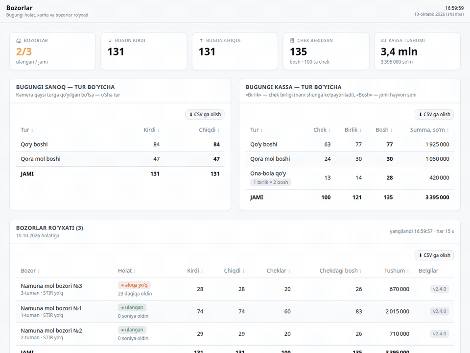
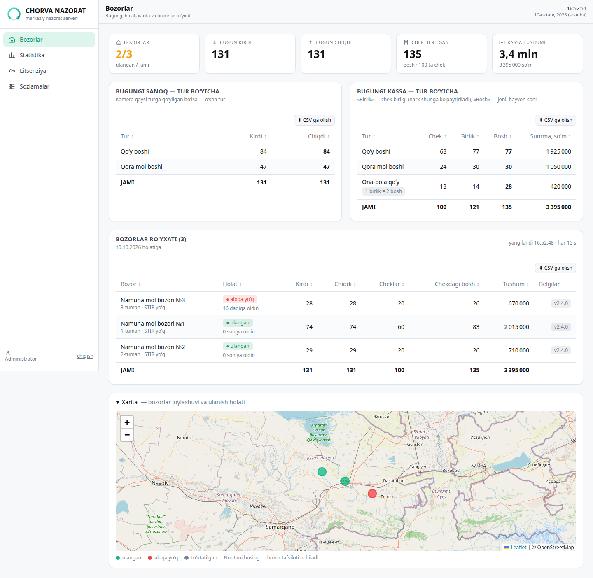
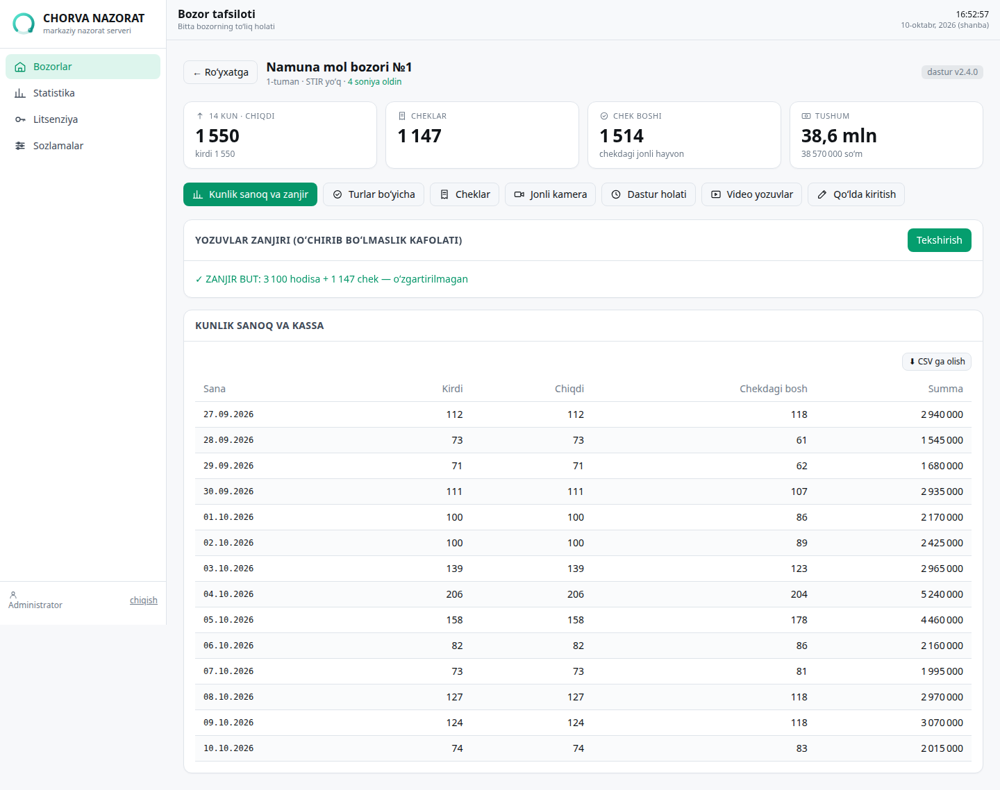
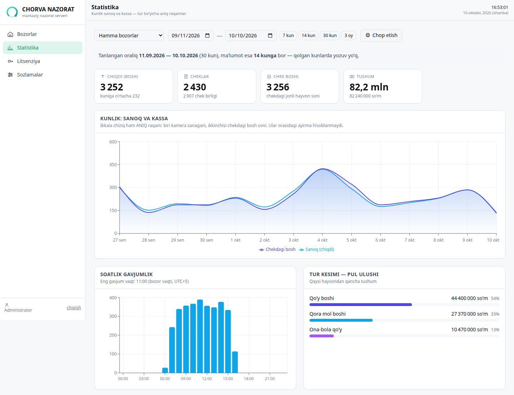
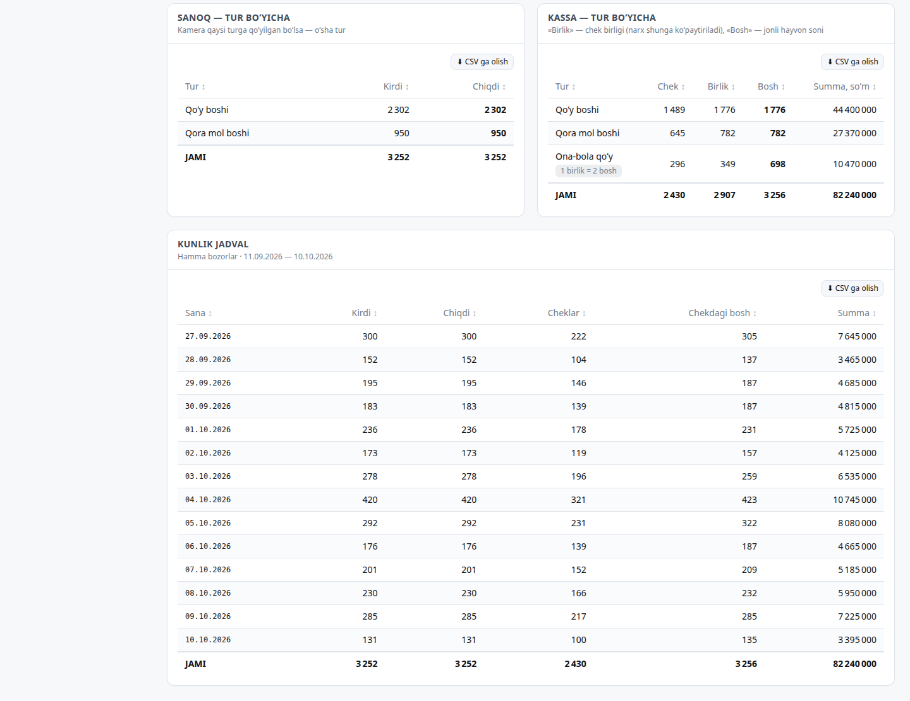
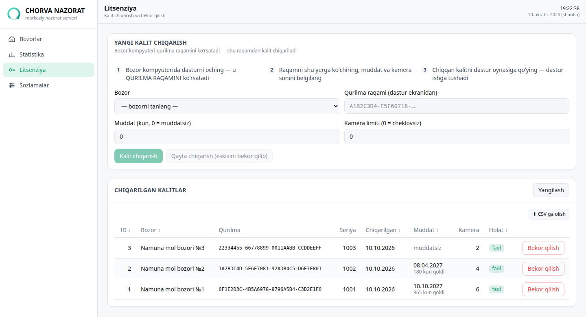
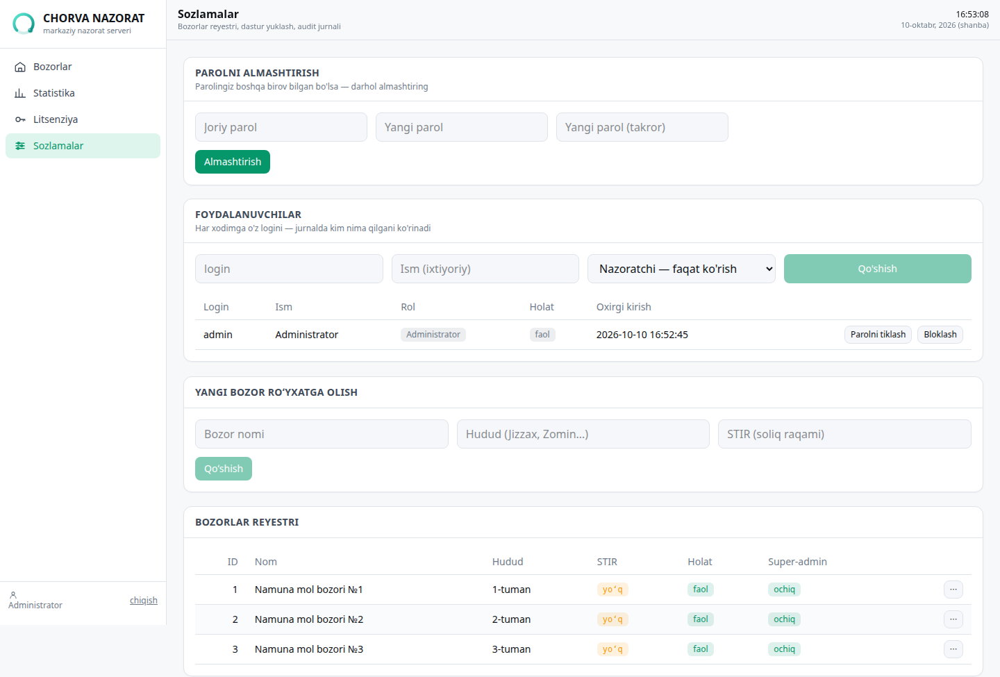
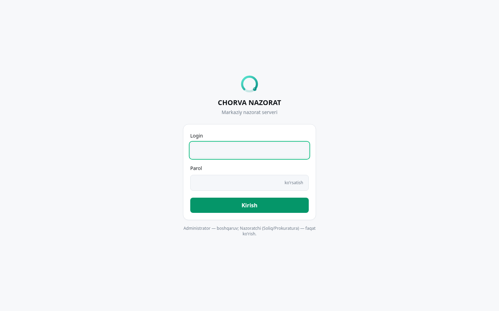
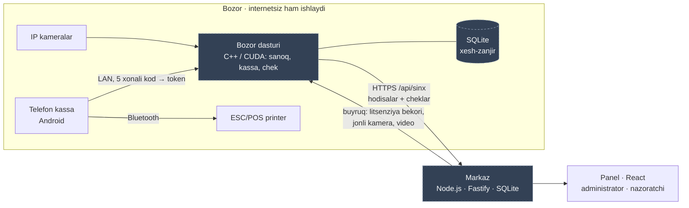

**Mol bozorlari uchun markaziy nazorat tizimi:** bozordagi dastur kamerada hayvonlarni sanaydi va chek chiqaradi, markaz esa barcha bozorlarning sanog'i, kassasi va litsenziyasini bitta panelda ko'rsatadi.

**Jonli:** [mol-bozor.unistart-hub.uz](https://mol-bozor.unistart-hub.uz)

---

## Markaz jonli ishlaydi

Bozordagi dastur internet bo'lganda hodisalar va cheklarni markazga yuboradi. Panel har 15 soniyada yangilanadi. Sanoq kamera turi bo'yicha, kassa esa chek turi bo'yicha alohida ko'rsatiladi.

## Asosiy qoidalar

| | |
|---|---|
| 💵 **Pul faqat chekdan** | Panelda «sanoq × narx» kabi taxminiy summa yo'q. Tushum faqat berilgan cheklardan hisoblanadi, chek bo'lmasa «hali chek berilmagan» deb yoziladi |
| 🐑 **Chek birligi va bosh alohida** | Ona-bola cheki 1 chek birligi, lekin 2 bosh hayvon hisoblanadi. Bozor dasturi aniq `bosh` sonini yuborsa, aynan shu son ishlatiladi |
| 📏 **Faqat aniq raqamlar** | Sanoq va kassa yonma-yon turadi, lekin ular orasidagi «farq» yoki «tafovut» foizi chiqarilmaydi |
| 🔗 **O'chirib bo'lmaydigan zanjir** | Har bir hodisa va chek oldingi yozuvning SHA-256 xeshini o'z ichiga oladi. Markaz zanjirni tekshiradi: o'rtadan bitta qator o'chirilsa yoki o'zgartirilsa, buzilgan joyni ko'rsatadi |
| 🔑 **Ed25519 litsenziya** | Kalit bozor kompyuterining qurilma raqami uchun chiqariladi. Muddat va kamera limiti belgilanadi, kalitni bekor qilish mumkin. Bekor qilish xabari keyingi sinxda bozorga yetib boradi |
| 👁️ **Faqat ko'rish roli** | Administrator boshqaradi, nazoratchi (soliq, prokuratura) esa faqat ko'radi. Nazoratchi biror narsani o'zgartirmoqchi bo'lsa, server 403 qaytaradi. Har bir amal audit jurnaliga yoziladi |

## Ekranlar

<table>
<tr>
<td width="50%"> <b>Bozorlar</b> — bugungi sanoq va kassa tur bo'yicha, ulanish holati, xarita</td>
<td width="50%"> <b>Bozor tafsiloti</b> — 14 kunlik ko'rsatkichlar, zanjir tekshiruvi, kunlik jadval</td>
</tr>
<tr>
<td> <b>Statistika</b> — kunlik sanoq va chekdagi bosh, soatlik gavjumlik, pul ulushi</td>
<td> <b>Tur kesimi va kunlik jadval</b> — chek, birlik, bosh, summa; CSV eksport</td>
</tr>
<tr>
<td> <b>Litsenziya</b> — qurilma raqami bo'yicha kalit, muddat, kamera limiti, bekor qilish</td>
<td> <b>Sozlamalar</b> — foydalanuvchilar, bozorlar reyestri, super-admin ruxsati</td>
</tr>
<tr>
<td> <b>Kirish</b> — login va parol</td>
<td></td>
</tr>
</table>

> Suratlar mahalliy demo bazadan olingan. Uchta «Namuna mol bozori», ularning hodisalari, cheklari, qurilma raqamlari va litsenziyalari **namuna ma'lumot**. Fiskal belgilar «SINOV» deb belgilangan.

## Arxitektura

- **Oflayn birinchi:** bozor dasturi markazga bog'liq emas. Internet uzilsa, yozuvlar navbatda turadi va aloqa tiklanganda yetkaziladi.
- **Bir yo'nalishli nazorat:** markaz bozorga faqat litsenziya bekori, jonli kamera surati va video so'rovi kabi buyruqlarni yuboradi.
- **Xarita:** Leaflet ishlatiladi. Internetsiz idorada xarita plitkasi o'chiriladi va bozorlar «sxema rejimida» koordinata bo'yicha ko'rsatiladi.

## Ochiq qismlar

| Papka | Nima bor |
|---|---|
| `markaz-panel/` | Markaz paneli (React 19, Vite, Tailwind, Recharts, react-leaflet): kirish, bozorlar, bozor tafsiloti, statistika, litsenziya, sozlamalar |
| `mobil-kassa/` | Telefon kassa ilovasi (Kotlin, minSdk 24, tashqi kutubxonasiz): LAN'da kompyuterni o'zi topadi, 5 xonali kod bilan ulanadi, chekni Bluetooth SPP orqali ESC/POS printerdan chiqaradi. `QUR_APK.ps1` — Windows'da yig'ish skripti |

## Yopiq qismlar

**Yadro va litsenziya moduli yopiq.** Quyidagilar repoga kiritilmagan:

| Qism | Nima qiladi |
|---|---|
| Bozor dasturi (C++17 / CUDA) | Video dekod, aniqlash, kuzatish, zona bo'yicha sanoq, kassa, chek, SQLite jurnal, markazga sinx |
| Markaz serveri (`src/`) | API, sessiya va rollar, baza sxemasi, pul va sanoq hisobi, zanjir tekshiruvi, litsenziya kaliti |
| Litsenziya (`ortak/`) | Ed25519 imzo, qurilma barmoq izi, PIN himoyasi |
| O'rnatuvchi va modellar | Windows o'rnatuvchisi, o'qitilgan model vaznlari |

## Sifat

- `node --test sinov/*_test.js` — **40 ta sinov o'tadi** (yopiq server kodi bilan birga turadi):
  - **30 ta API sinovi:** kirish, rollar (nazoratchi 403 oladi), sinx, ona-bola = 2 bosh, taxminiy pul yo'qligi, zanjir, litsenziya;
  - **10 ta kross-sinov:** markaz Node.js'da yasagan litsenziya kaliti va bekor yozuvini bozor dasturining C++ kodi bayt-ma-bayt bir xil o'qishi tekshiriladi.

## Texnologiyalar

Node.js 22 · Fastify 5 · better-sqlite3 · React 19 · Vite · Tailwind CSS 4 · Recharts · Leaflet · Kotlin (Android) · Bluetooth SPP / ESC/POS · Ed25519 · SHA-256 xesh-zanjir · Docker + Caddy

---

**Yadro va litsenziya moduli yopiq.** Namoyish yoki hamkorlik bo'yicha: Telegram [@Humoyun_Davronov](https://t.me/Humoyun_Davronov)

Muallif — Humoyun Davronov

